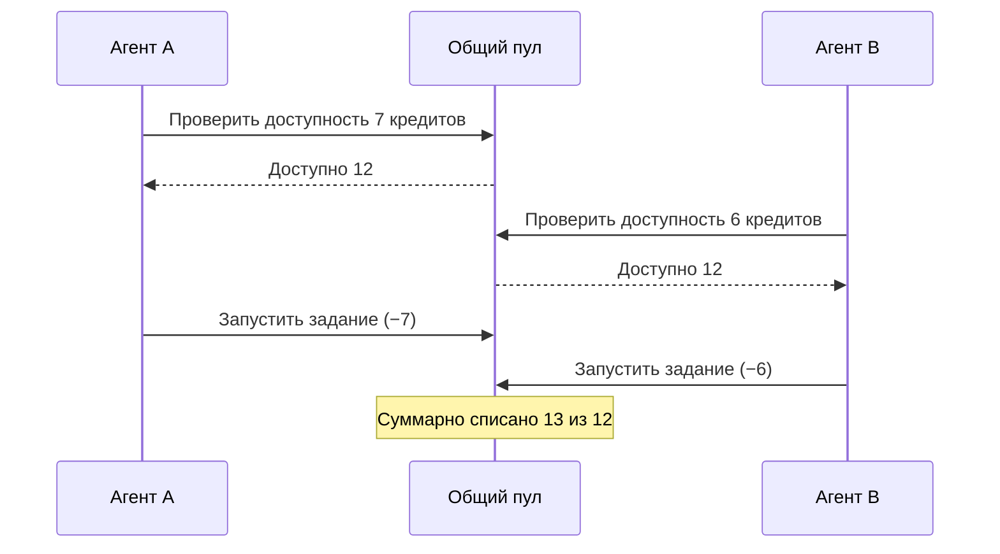

# Проект D. Безопасность LLM-агентов при совместном использовании ресурсов

## 1. Проблема

Несколько автономных LLM-агентов могут выполнять независимые задачи, используя один ограниченный ресурс: вычислительные кредиты, общий API-бюджет или квоту на запуск заданий. Каждый агент принимает решения на основании доступного ему состояния системы, но эти сведения могут устареть до выполнения действия. В результате запросы, допустимые по отдельности, при одновременном исполнении могут нарушить общий лимит.

Проблема возникает на границе между **решением агента** и **фактическим действием инструмента**. Корректно рассуждающие агенты не обеспечивают согласованность общего состояния, если проверка доступного ресурса и его расходование не согласованы между собой. Требуется выяснить, в каких условиях это приводит к сбоям и какие механизмы координации предотвращают их, сохраняя возможность выполнять полезные задачи.

### Пример: два задания в общей вычислительной квоте

Два исследователя поручают своим агентам подготовить проверки ML-моделей. На оба задания выделено **12 вычислительных кредитов**. Первый агент выбирает расширенную проверку стоимостью **7**, второй - регрессионный тест стоимостью **6**. Каждый видит 12 свободных кредитов и считает свой запуск допустимым.

Это пример `race condition`: обе проверки прошли, но между проверкой и списанием ресурс не был зарезервирован. Если бы второй запуск выполнялся через **атомарную проверку и резервирование**, он получил бы отказ при остатке 5. Другой возможный выход - это **согласование до запуска**: например, первый агент может выбрать сокращённую проверку за 4 кредита, и оба задания поместятся в бюджет (4 + 6 = 10). Таким образом, отсутствие нарушений и полезность выполненной работы являются разными свойствами системы.

Этот сценарий показателен для агентных сервисов, в которых несколько пользователей одновременно делят работу, а ресурсы и ограничения остаются общими. Здесь важно оценивать не только рассуждения LLM, но и реальные последствия вызовов инструментов.

## 2. Исследовательский вопрос и гипотезы

**Основной вопрос:** *Как параллельность запросов и обмен информацией между LLM-агентами влияют на соблюдение общего ресурсного лимита, и какой ценой для полезности задач этот лимит можно обеспечить на уровне исполняющей системы?*

**Три гипотезы:**

- **H1 - зависимость от конкурентности.** При неатомарном списании нарушения будут возникать чаще, когда запросы перекрываются во времени, а суммарная потребность превышает доступный лимит. 
  
  **Проверка:** сравним частоту превышений при разных интервалах между запросами и задержках между проверкой и списанием, сохраняя задания и начальный бюджет.
- **H2 - ограниченность коммуникации.** Обмен сообщениями между агентами может уменьшить число конфликтов, но сам по себе не гарантирует соблюдение лимита, особенно при почти одновременных решениях или устаревшей информации. Гипотеза мотивирована результатами DPBench и *Worse Together* [1, 2].
  
  **Проверка:** сравним одни и те же сценарии с доступным и недоступным каналом сообщений; рассмотрим задержки доставки. 
- **H3 - безопасность и полезность.** Атомарное резервирование устранит превышения лимита в рамках заданной модели, однако не гарантирует наилучший выбор заданий: возможны отказы, простаивание остатка бюджета или упущенная полезность. 
  
  **Проверка:** вместе с нарушениями измерим полезность корректно завершённых заданий, отказы и задержку; сопоставим результат с максимально достижимой полезностью при том же бюджете.

Утверждение об отсутствии превышений при корректном атомарном резервировании является свойством механизма, а не предполагаемым новым открытием. Исследовательский интерес H3 заключается в поведении LLM-агентов и фактических потерях/выигрышах при соблюдении этого ограничения.
