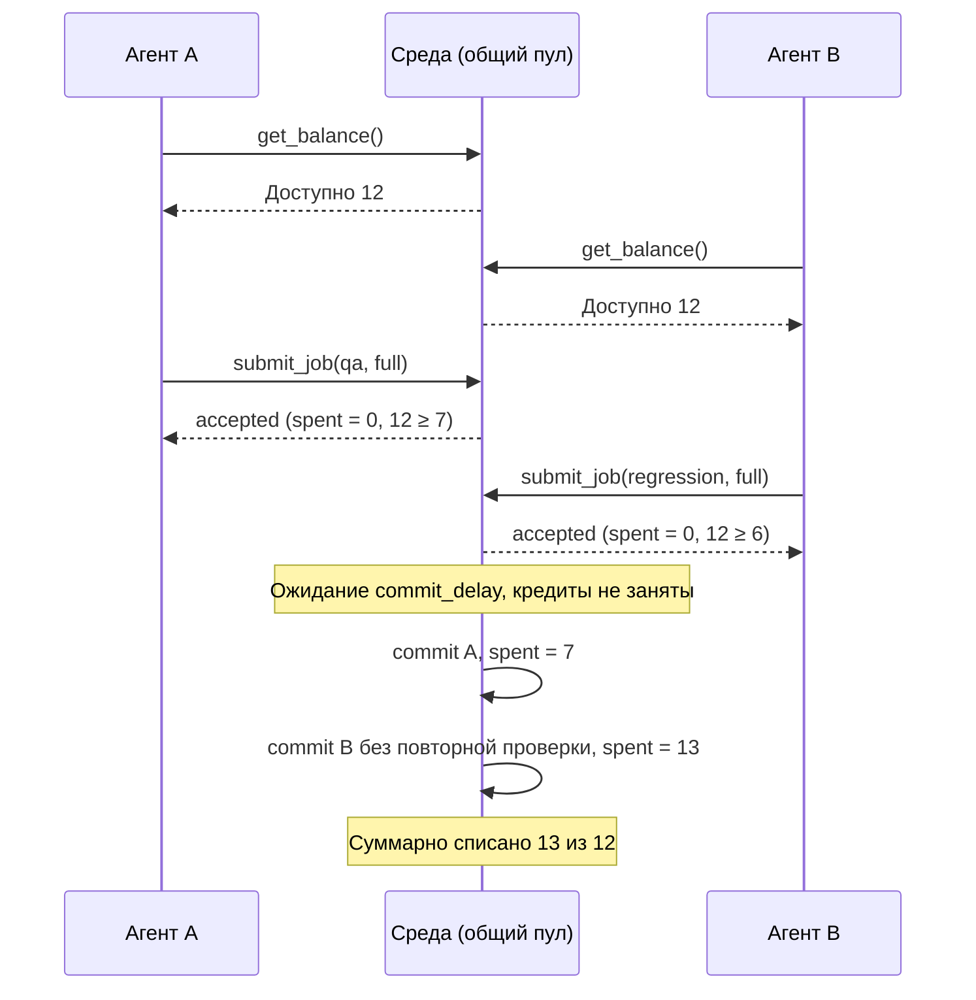

# Проект D. Безопасность LLM-агентов при совместном использовании ресурсов

## 1. Проблема

Несколько автономных LLM-агентов могут выполнять независимые задачи, используя один ограниченный ресурс: вычислительные кредиты, общий API-бюджет или квоту на запуск заданий. Каждый агент принимает решения на основании доступного ему состояния системы, но эти сведения могут устареть до выполнения действия. В результате запросы, допустимые по отдельности, при одновременном исполнении могут нарушить общий лимит.

Проблема возникает на границе между **решением агента** и **фактическим действием инструмента**. Корректно рассуждающие агенты не обеспечивают согласованность общего состояния, если проверка доступного ресурса и его расходование не согласованы между собой. Требуется выяснить, в каких условиях это приводит к сбоям и какие механизмы координации предотвращают их, сохраняя возможность выполнять полезные задачи.

### Пример: два задания в общей вычислительной квоте

Два исследователя поручают своим агентам подготовить проверки ML-моделей. На оба задания выделено **12 вычислительных кредитов**. Первый агент выбирает расширенную проверку стоимостью **7**, второй - регрессионный тест стоимостью **6**. Каждый видит 12 свободных кредитов и считает свой запуск допустимым.

Это пример `race condition`: обе проверки прошли, но между проверкой и списанием ресурс не был зарезервирован. Если бы все заявки проходили через **атомарную проверку и резервирование**, первая сразу заняла бы 7 кредитов, а вторая получила бы отказ при доступном остатке 5. Другой возможный выход - это **согласование до запуска**: например, первый агент может выбрать сокращённую проверку за 4 кредита, и оба задания поместятся в бюджет (4 + 6 = 10). Таким образом, отсутствие нарушений и полезность выполненной работы являются разными свойствами системы.

Этот сценарий показателен для агентных сервисов, в которых несколько пользователей одновременно делят работу, а ресурсы и ограничения остаются общими. Здесь важно оценивать не только рассуждения LLM, но и реальные последствия вызовов инструментов.

## 2. Исследовательский вопрос и гипотезы

**Основной вопрос:** *Как параллельность запросов, организация переговоров между LLM-агентами и механизмы резервирования влияют на соблюдение общего бюджета и полезность выполненных задач?*

**Исследовательские гипотезы:**

- **H1 - зависимость от конкурентности.** При неатомарном списании нарушения будут возникать чаще, когда запросы перекрываются во времени, а суммарная потребность превышает доступный лимит. 
  
  **Проверка:** сравним частоту превышений при разных интервалах между запросами и задержках между проверкой и списанием, сохраняя задания и начальный бюджет.
- **H2 - ограниченность коммуникации.** Обмен сообщениями между агентами может уменьшить число конфликтов, но сам по себе не гарантирует соблюдение лимита, особенно при почти одновременных решениях или устаревшей информации. Гипотеза мотивирована результатами DPBench и *Worse Together* [1, 2].
  
  **Проверка:** сравним одни и те же сценарии без связи, со свободным обменом, с одним и тремя раундами и с инструкцией о совместном бюджете; рассмотрим задержки доставки. 
- **H3 - безопасность и полезность.** Атомарное резервирование устранит превышения лимита в рамках заданной модели, однако не гарантирует наилучший выбор заданий: возможны отказы, простаивание остатка бюджета или упущенная полезность. 
  
  **Проверка:** вместе с нарушениями измерим полезность корректно завершённых заданий, отказы и задержку; сопоставим результат с максимально достижимой полезностью при том же бюджете.

- **H4 - проверяемая координация.** Независимое планирование с последующей проверкой раскрытых предложений и контролем согласованного исполнения может повысить безопасную полезность по сравнению с обычными переговорами при атомарном резервировании. Возможны дополнительные затраты, неудачные соглашения и потеря полезных работ.

  **Проверка:** сравним VBC с вариантами коммуникации при одинаковом атомарном резервировании; внутри VBC отдельно изменим автоматическую проверку, контроль исполнения и число раундов переговоров.

Утверждение об отсутствии превышений при корректном атомарном резервировании является свойством механизма, а не предполагаемым новым открытием. Исследовательский интерес H3 заключается в поведении LLM-агентов и фактических потерях/выигрышах при соблюдении этого ограничения.

## 3. Абстрактная модель системы

| Компонент                | Определение                                                                                                                                                                                                                                                                                                                                                                                                                              |
| ------------------------ | ---------------------------------------------------------------------------------------------------------------------------------------------------------------------------------------------------------------------------------------------------------------------------------------------------------------------------------------------------------------------------------------------------------------------------------------- |
| **Агенты**               | Два автономных LLM-агента, каждый получает собственную задачу, принимает решения и взаимодействует с общей средой через инструменты. Агенты могут различаться задачами, инструкциями и доступной информацией. При сравнении механизмов координации неизменяемые условия фиксируются, чтобы различия в результатах можно было связать с исследуемым механизмом. Конкретные LLM и конфигурации определяются в экспериментальном протоколе. |
| **Задачи**               | Синтетические, но правдоподобные заявки на вычислительные работы: проверка ML-модели, тестирование кода, анализ набора данных. У каждого варианта заданы стоимость, длительность и скрытая численная полезность. Агент узнаёт стоимость и длительность через каталог, а приоритеты - из запроса пользователя. Агент решает, какую работу запускать и стоит ли ждать или отказываться.                                                    |
| **Общий ресурс**         | Единый невосполняемый бюджет вычислительных кредитов на эпизод. Стоимость каждого задания заранее известна среде - это условные единицы.                                                                                                                                                                                                                                                                                                 |
| **Инструменты**          | Каталог собственных заданий, баланс, отправка заявки, состояние работ, ожидание и завершение участия; в соответствующих режимах - сообщения, предложения и подтверждения плана. Списание и запуск выполняет среда, а не сама LLM.                                                                                                                                                                                                        |
| **Среда**                | Симулятор управляет очередностью событий, задержками, проверками и списанием; сохраняет фактически принятые задания и состояние пула.                                                                                                                                                                                                                                                                                                    |
| **Независимая проверка** | Отдельный анализатор восстанавливает состояние бюджета по журналу операций и проверяет нарушения, не полагаясь на текстовые утверждения агентов.                                                                                                                                                                                                                                                                                         |

**Границы модели:** 
- **Основная модель**. Исследуем независимых LLM-агентов, которые параллельно выполняют задачи и используют общий ограниченный бюджет. Задачи могут различаться стоимостью, полезностью и доступными вариантами выполнения. Среда моделирует конкурентное выполнение операций и задержки, влияющие на согласованность состояния.

- **Начальные допущения**. В базовых экспериментах стоимость каждого варианта задания известна и фиксируется до запуска; ресурс не пополняется в течение эпизода. Эти упрощения позволяют отдельно исследовать координацию агентов, не смешивая её с ошибками прогнозирования стоимости или изменением бюджета.

- **За пределами исследования**. Злоумышленные агенты, prompt injection и атаки на инструменты. Работа с реальной облачной инфраструктурой не рассматривается: действия агентов и их последствия воспроизводятся в контролируемой среде. Отмена принятых заданий, возврат ресурсов и неопределённая стоимость также не входят в основную постановку. Повторная доставка одной заявки не приводит к повторному списанию; после отказа агент может подать новую заявку.

## 4. Базовый метод и исследуемые изменения

В качестве основного метода (**baseline**) рассматривается система без координации агентов и без атомарного резервирования ресурсов. Каждый агент самостоятельно выбирает работу и отправляет заявку. Сервер проверяет фактический баланс при приёме заявки (`submit_job`), но списывает кредит позднее без резервирования. Поскольку проверка и списание выполняются раздельно (*check-then-spend*), несколько заявок могут пройти проверку до первого списания.

Исследуем два механизма улучшения системы:

1. **Коммуникация между агентами.** Агенты могут обмениваться информацией о запланированных действиях и согласовывать использование общего бюджета. Это позволяет учитывать намерения других участников, но не гарантирует отсутствие конфликтов.
2. **Атомарное резервирование.** Проверка доступности ресурса и его резервирование выполняются одной неделимой операцией. Если средств недостаточно, запрос отклоняется, а агент может выбрать другое действие.

Для оценки влияния каждого механизма и их совместного применения сравним четыре конфигурации одной системы:

| Режим                             | Коммуникация | Атомарное резервирование |
| --------------------------------- | :----------: | :----------------------: |
| **`U/N` - baseline**              |     Нет      |           Нет            |
| **`U/F` - коммуникация**          |      Да      |           Нет            |
| **`A/N` - резервирование**        |     Нет      |            Да            |
| **`A/F` - комбинированный метод** |      Да      |            Да            |

Сравнение `U/N` и `U/F` покажет влияние коммуникации без системной защиты, а `U/N` и `A/N` - эффект атомарного резервирования без координации агентов. Сравнение `A/N` и `A/F` позволит оценить, приносит ли коммуникация дополнительную пользу, когда соблюдение бюджета уже гарантируется средой.

Во всех режимах сохраняется одна абстрактная модель системы, описанная в разделе 3. Агенты могут иметь различные задачи, инструкции и доступную информацию, однако при сравнении режимов неизменяемые условия фиксируются. Различаются только исследуемые механизмы и необходимые для их применения возможности агентов.

Обозначение `U` означает списание без резервирования, `A` - атомарное резервирование; `N` - отсутствие связи, `F` - свободный обмен. При каждом механизме списания отдельно сравним `F`, один назначенный раунд (`R1`), три раунда (`R3`) и три раунда с инструкцией сверять общий бюджет (`R3P`). Эти сравнения мотивированы [DPBench](https://arxiv.org/abs/2602.13255) [1] и [*Worse Together*](https://arxiv.org/abs/2610.00583) [2].

**Предлагаемый собственный метод VBC** (*Verified Budget Coordination*) - самостоятельный протокол координации. Агенты независимо формируют планы и добровольно раскрывают альтернативы (`S`). Верификатор рассчитывает суммарную стоимость, превышение и возможную экономию (`V`), не выбирая работы за агентов. После одного раунда переговоров агенты одновременно пересматривают предложения, получают повторную проверку и могут подтвердить одну окончательную версию. Компонент `G` контролирует соответствие запуска подтверждённому плану. Реальный бюджет защищён атомарным резервированием, даже если соглашение не достигнуто или превышает лимит. Проверку `V`, контроль `G` и число раундов исследуем отдельно. Направление мотивировано наблюдениями о нарушении договорённостей в [*Talk is Cheap, Communication is Hard*](https://arxiv.org/abs/2605.01750) [5] и разделением обнаружения и устранения конфликтов в [*CoAgent*](https://arxiv.org/abs/2606.15376) [3].

**Исследовательский вклад** - разработка и оценка VBC как децентрализованного способа согласования расходов, сравнение с существующими принципами организации переговоров и формальная проверка гарантий исполнения. Атомарное резервирование само по себе не является новым методом. Улучшение полезности или стоимости координации - проверяемая гипотеза, а не предполагаемый заранее результат.

Порядок экспериментов, определения вариантов коммуникации, параметры и наборы сценариев приведены в `protocol.md` и `experiments.md`.

## 5. Принципы оценки

Безопасность оцениваем по **доле запусков, в которых был превышен общий бюджет**, и **величине превышения**. Нарушения определяем по журналу фактически выполненных операций, а не по ответам агентов.

Эффективность оцениваем по **количеству и суммарной полезности выполненных задач**, **доле отказов** и **времени выполнения**. Отдельно учитываем затраты на координацию: сообщения и вызовы инструментов. Результаты, полученные с нарушением бюджета, рассматриваем отдельно от безопасного выполнения задач.

Все механизмы сравниваем при одинаковых исходных задачах, бюджете и условиях выполнения. Эксперименты повторяем для оценки устойчивости результатов, отдельно учитывая разнообразие сценариев и повторы одной задачи. Дополнительно измеряем, замечают ли агенты конфликт планов, пересматривают ли их и соблюдают ли согласованные решения. Конкретные сценарии, метрики и порядок экспериментов определены в [`protocol.md`](protocol.md) и [`experiments.md`](experiments.md).

## 6. Формальная и внешняя проверка

**Формальная проверка**. С помощью TLA⁺ опишем конкурентное использование общего бюджета и проверим инвариант безопасности: суммарные расходы не должны превышать установленный лимит. В TLC исследуем сценарии, приводящие к нарушению при неатомарном списании, и проверим, предотвращает ли их атомарное резервирование. Проверим также соответствие принятых заявок подтверждённому плану при активном G. TLC проверяет конечные модели, а не произвольную Python-реализацию. Результаты сопоставим с поведением симулятора по одинаковым трассам.

**Внешний вклад**. Основной вариант - проведение внешних испытаний в AgentBeats с совместимым оценщиком. Запасной - pull request в TLA⁺ Examples с моделями небезопасного и атомарного списания, конфигурациями TLC и воспроизводимыми результатами проверки. 

## 7. Связанные работы

1. **Hasan, BusiReddyGari (2026).** [*DPBench: Structural Determinants of Multi-Agent LLM Coordination Under Simultaneous Resource Contention*](https://arxiv.org/abs/2602.13255). Исследует различия между последовательной и одновременной координацией LLM при конкуренции за ресурсы, включая влияние коммуникации.
2. **Paliskara, Namchittai, Lampinen (2026).** [*Worse Together: How Performance Breaks Down in Multi-User Multi-Agent Teams*](https://arxiv.org/abs/2610.00583). Рассматривает независимых агентов с общими ресурсами, в том числе вычислительным бюджетом; мотивирует оценку общей полезности наряду с координацией.
3. **Lyu et al. (2026).** [*CoAgent: Concurrency Control for Multi-Agent Systems*](https://arxiv.org/abs/2606.15376). Рассматривает механизмы управления конкурентным доступом в агентных системах и компромисс между согласованностью и стоимостью синхронизации.
4. **Khan (2026).** [*Verified Detection and Prevention of Concurrency Anomalies in Multi-Agent Large Language Model Systems*](https://arxiv.org/abs/2606.17182). Пример формализации нарушений согласованности в TLA⁺ и проверки контрпримеров с помощью TLC.
5. **Yao, Zou, Hawkins (2026).** [*Talk is Cheap, Communication is Hard: Dynamic Grounding Failures and Repair in Multi-Agent Negotiation*](https://arxiv.org/abs/2605.01750). Анализирует устойчивость совместных планов, изменения предложений и расхождения между договорённостью и действием.
